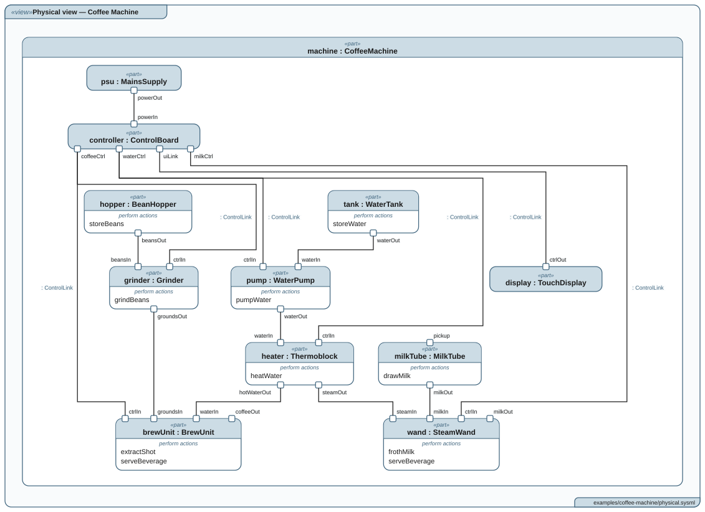
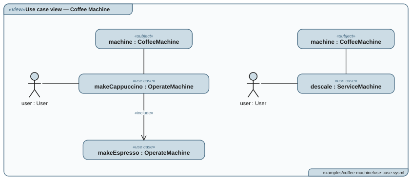
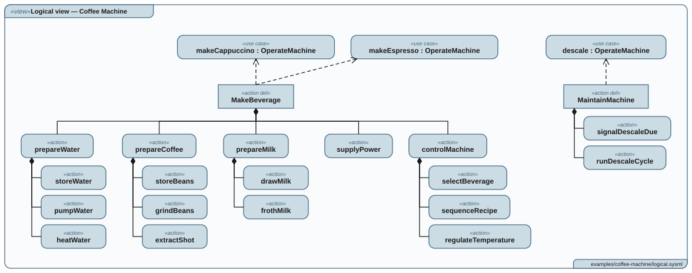
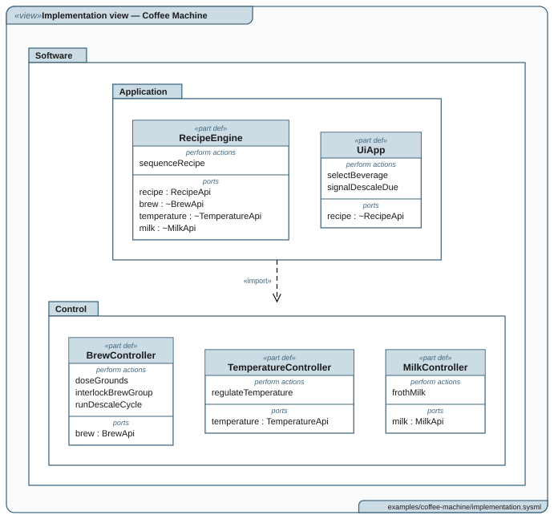
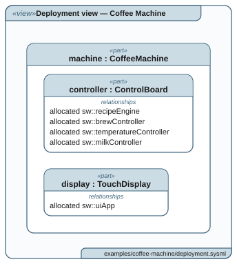
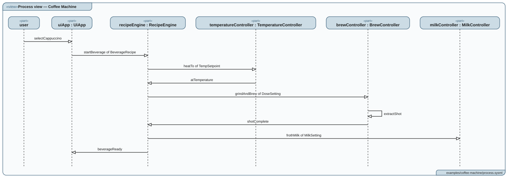

<h1>
  <picture>
    <source media="(prefers-color-scheme: dark)" srcset="logo/ortho-logo-dark.svg">
    
  </picture>
</h1>

**Architecture diagrams from SysML v2 text.** Write your model in the SysML v2
textual notation, commit it next to your code, and `ortho` draws six
architectural views of it as SVG, in SysML v2's own graphical notation: use
case, logical, implementation, physical, deployment and process. Just as a
technical drawing shows one object through several standard views, so the
diagrams show one model.

<p align="center">
  
</p>

## Why ortho

- **The model is the source, the diagrams follow.** Every view is drawn from
  the text, so a diagram cannot drift from the model, and a review shows the
  change to both.
- **Standard SysML v2.** ortho reads the textual notation of OMG SysML v2.0
  and loads all 252 of OMG's example, training and validation models. A view is
  declared with the standard view definitions, so another SysML v2 tool can
  read the same model.
- **SysML v2's graphical notation** (§8.2.3): definitions and usages, «part»
  and «action» keywords, ports on the border, «include» and «import» arrows.
- **One program, nothing else.** No modelling tool, no licence server, no
  Java, no browser and no network calls. The same model gives the same SVG on
  a laptop and in CI.
- **Drawn to be read on paper and slides.** Diagrams are sized for landscape
  A4, ortho warns of one too big to read there, and a dark theme suits slides.

## The six views

One model, six views of it, each answering one question. These are the
[coffee machine example](examples/coffee-machine/); click a diagram to see it
full size.

<table>
  <tr>
    <td align="center" valign="top"><a href="VIEWS.md#use-case-view"><b>Use case</b></a><br>
      <a href="examples/coffee-machine/diagrams/use-case-view-coffee-machine.svg"></a></td>
    <td align="center" valign="top"><a href="VIEWS.md#logical-view"><b>Logical</b></a><br>
      <a href="examples/coffee-machine/diagrams/logical-view-coffee-machine.svg"></a></td>
  </tr>
  <tr>
    <td align="center" valign="top"><a href="VIEWS.md#implementation-view"><b>Implementation</b></a><br>
      <a href="examples/coffee-machine/diagrams/implementation-view-coffee-machine.svg"></a></td>
    <td align="center" valign="top"><a href="VIEWS.md#physical-view"><b>Physical</b></a><br>
      <a href="examples/coffee-machine/diagrams/physical-view-coffee-machine.svg"></a></td>
  </tr>
  <tr>
    <td align="center" valign="top"><a href="VIEWS.md#deployment-view"><b>Deployment</b></a><br>
      <a href="examples/coffee-machine/diagrams/deployment-view-coffee-machine.svg"></a></td>
    <td align="center" valign="top"><a href="VIEWS.md#process-view"><b>Process</b></a><br>
      <a href="examples/coffee-machine/diagrams/process-view-coffee-machine.svg"></a></td>
  </tr>
</table>

| View | Shows | Drawn from what you write |
| --- | --- | --- |
| Use case | How the system is used, and by whom | `use case`, `subject`, `actor`, `include` |
| Logical | What the system does: a tree of functions, and the use case each refines | `action def`, `action`, `#refinement dependency` |
| Implementation | The static structure of the software: packages, modules, their APIs and the functions they perform | `package`, `part def`, `port`, `perform` |
| Physical | The product itself: its parts, their ports and how they are wired | `part`, `port`, `connect`, `interface` |
| Deployment | Which hardware runs which software | `allocate` |
| Process | How the software modules talk at run time, as a sequence of messages | `occurrence def`, `message` |

Every view stands alone: a model needs only the views it wants, and a view
names another only where it refers to something in it. [VIEWS.md](VIEWS.md)
says what each view is for, and [LANGUAGE.md](LANGUAGE.md) what to write for it.

## Install

In VS Code, install
[Ortho for SysML v2](https://marketplace.visualstudio.com/items?itemName=ola-coding.ortho)
from the Marketplace; in Cursor or VSCodium, from
[Open VSX](https://open-vsx.org/extension/ola-coding/ortho). It carries
ortho, draws the views beside the model as you edit it, and puts ortho on
the PATH of VS Code's terminals, so there is nothing else to install.

Otherwise, download ortho for your system from the
[latest release](https://github.com/ola-coding/ortho/releases/latest):

| System               | File                                      |
| -------------------- | ----------------------------------------- |
| Windows              | `ortho-x86_64-pc-windows-msvc.zip`        |
| macOS, Apple silicon | `ortho-aarch64-apple-darwin.tar.gz`       |
| macOS, Intel         | `ortho-x86_64-apple-darwin.tar.gz`        |
| Linux, x86-64        | `ortho-x86_64-unknown-linux-musl.tar.gz`  |
| Linux, ARM           | `ortho-aarch64-unknown-linux-musl.tar.gz` |

Unpack it and put `ortho` (`ortho.exe` on Windows) in a folder on your `PATH`.
On Linux or macOS, from a terminal:

```sh
curl -L https://github.com/ola-coding/ortho/releases/latest/download/ortho-aarch64-apple-darwin.tar.gz | tar xz
sudo mv ortho-aarch64-apple-darwin/ortho /usr/local/bin/
```

with the file for your system in place of the Apple silicon one. On macOS, a
file downloaded with a browser is quarantined, and macOS refuses to open it;
`xattr -d com.apple.quarantine ortho` lifts that. Check that it works with
`ortho --version`.

With [Rust](https://rustup.rs) installed, ortho is also on
[crates.io](https://crates.io/crates/ortho):

```sh
cargo install ortho    # builds it from source
cargo binstall ortho   # downloads the release binary, with cargo-binstall
```

## Your first diagram

Create `logical.sysml`:

```sysml
package Functions {
    private import StandardViewDefinitions::*;

    action def MakeBeverage {
        action prepareWater {
            action storeWater;
            action heatWater;
        }
        action prepareCoffee {
            action grindBeans;
            action extractShot;
        }
        action controlMachine {
            action selectBeverage;
            action sequenceRecipe;
        }
    }

    view 'Logical view — Coffee Machine' : GeneralView {
        expose MakeBeverage;
    }
}
```

The `view` at the end is the diagram: its name is the heading, and it shows
what it exposes. Render it:

```sh
ortho render logical.sysml -o diagrams
```

Open `diagrams/logical-view-coffee-machine.svg` in a browser: a tree of ten
functions, headed "Logical view — Coffee Machine".

## Options

```text
ortho render <models...> -o <folder> [--theme <name>] [--watch]
```

- `<models...>`: `.sysml` files, or folders of them, read as one model.
- `-o, --out`: the folder to write to, one SVG per view, named after the view:
  `view 'Logical view'` writes `logical-view.svg`, and a short name,
  `view <logical> 'Logical view'`, `logical.svg`. Missing folders are created.
- `--theme`: `light` (default) or `dark-glass`, a transparent version for dark
  slides. PowerPoint, Keynote and Google Slides all insert SVG directly.
- `-w, --watch`: keep running and render again whenever a model file is saved,
  so an SVG preview open beside the model in your editor follows the text. A
  `.sysml` file added to a folder you named is picked up too, and a model that
  does not load is reported and waited on. Stop it with Ctrl+C.

Each box in a diagram carries the file and line that declare its element,
as `data-file` and `data-line` on its group, the file named from the folder
ortho ran in. A viewer can take you from a box to the text, as the VS Code
extension does when you click one.

`ortho init` writes AI instructions into the current folder, a skill for
Claude Code and instructions for GitHub Copilot, so an agent there knows the
SysML v2 ortho reads and checks its work with ortho.
`ortho init --example coffee-machine` also copies that example, or
`survey-drone`, into a folder of its own.

`ortho lsp` runs ortho as a language server, for an editor that speaks the
Language Server Protocol, such as Zed, Neovim, Helix or Emacs: the problems
of every file in a model's folder as you type, go to definition, and the
diagrams written to `diagrams/` beside the model on every save.

Diagrams are drawn for landscape A4. A view too big for that page, one whose
names would print smaller than 6 pt once it is shrunk to fit, is still drawn,
with a warning that says so: split it into smaller views, as
[LANGUAGE.md](LANGUAGE.md#keeping-a-view-on-one-page) shows.

## Using it in a project

ortho renders every view a model declares, so one command draws them all.
Commit your models and the generated SVGs:

```sh
ortho render models -o diagrams
```

Rendering is deterministic, so CI can render again and fail if Git shows a
change: the diagrams can never drift from the models. In GitHub Actions:

```yaml
- name: Diagrams are up to date
  run: |
    curl -sSL https://github.com/ola-coding/ortho/releases/latest/download/ortho-x86_64-unknown-linux-musl.tar.gz | tar xz -C "$RUNNER_TEMP"
    "$RUNNER_TEMP/ortho-x86_64-unknown-linux-musl/ortho" render models -o diagrams
    test -z "$(git status --porcelain diagrams)" || { git status diagrams; exit 1; }
```

To keep every run on the same version, use `releases/download/v0.3.0/` in
place of `releases/latest/download/`.

## Examples

Two complete models, each with all six views rendered in its `diagrams/`
folder:

- [examples/coffee-machine/](examples/coffee-machine/): a bean-to-cup coffee
  machine. The smaller one, and the best place to start reading.
- [examples/survey-drone/](examples/survey-drone/): a quadcopter that surveys
  an area from the air, with a tablet ground station.

The [pitch deck](https://ola-coding.github.io/ortho/) shows every view of
both, with the model source beside each diagram.

## What ortho does not do

- **It is not an editor.** Write the model in any text editor; ortho only
  draws it.
- **It draws six views, not every SysML v2 diagram.** Requirements, states,
  calculations and constraints parse, so a full model loads, but no view draws
  them yet ([LANGUAGE.md](LANGUAGE.md#parsed-not-drawn)).
- **It does not load the standard library.** It knows the library's names, so
  a model may use them, and shows them as written.

ortho is young, at version 0.3. The [backlog](DEVELOPMENT.md#backlog) lists
what comes next, and issues are welcome.

## Learn more

- [VIEWS.md](VIEWS.md): what each view is for, and how it looks.
- [LANGUAGE.md](LANGUAGE.md): what to write, view by view.
- [DEVELOPMENT.md](DEVELOPMENT.md): for working on ortho itself.

## License

MIT, see [LICENSE](LICENSE).
