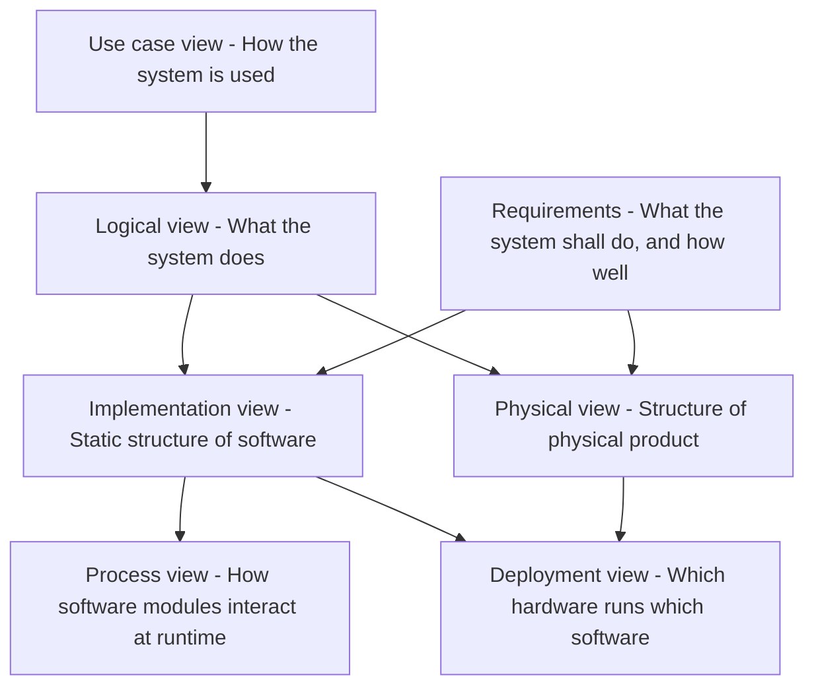

# The six views

ortho's views follow Kruchten's 4+1, with two changes. His Physical view is
split in two: **Physical** is the product itself — mechanics, electronics,
cabling and computers — and **Deployment** is which hardware runs which
software. And the **Logical** view holds the functions themselves, not the
structure that delivers them; that structure lives on Implementation and
Physical.

Start from what users need (Use case), sort it into functions (Logical),
realize them in software (Implementation) and hardware (Physical), place the
one on the other (Deployment), and show how the software talks at run time
(Process). Beside the use cases, the requirements say what the system shall
do, and how well; the software and hardware say which of them they satisfy.

Every arrow is optional. A view needs another only where its model names
something in it, so one can stand alone: an implementation view of a cloud
solution built from a vendor's services needs no use cases or functions.

[LANGUAGE.md](LANGUAGE.md) says what to write for each view;
[README.md](README.md) how to render it.

Every view is drawn in SysML v2's graphical notation (§8.2.3). A definition
is a box with square corners and a usage one with rounded corners, each with
its keyword above its name: «part def», «part», «action». The frame's tab
names the view, and its bottom-right corner the file that declares it. The
notation leaves colour open, so ortho's carries no meaning: one flat tint marks
a box's name, and the keyword says what the box is.

## Use case view

How the system is used, and by whom — nothing about how it works.

Each use case is drawn as SysML v2 draws one (Part 1, Table 23): the use case,
a «use case» box, with its subject, a «subject» box, above it, its primary
actors, stick figures, to its left, its secondary ones to its right, and the
use cases it includes below it, each joined by a solid «include» arrow. The
subject and the actors are the use case's own, so each use case draws its own
copy of them, and no line crosses another. The groups stand in rows as wide as
landscape A4, in the order the model declares them.

## Logical view

What the system does, as a tree of functions, whatever ends up performing
them. Functions outlive their realizations: arming a mechanism has been a
hatch, a relay and firmware. Control functions — arming, interlocking,
sequencing — move between media; energy and material functions — containing
a volume, raising a temperature — do not.

Each function appears once, and names nothing that realizes it: the parts on
the Implementation and Physical views name their functions themselves. A
function nothing performs is a gap. Each tree details what a use case asks for,
and says so: it refines that use case. A use case nothing refines is a gap too,
which ortho finds from the model, so the view may draw the trees alone.

Drawn as a work-breakdown chart: one box per function, the root an «action
def» and the rest «action»s, each parent above its children on a single stem.
The stem leaves the parent at a filled diamond, since the parent owns them.
A use case the view exposes stands above its tree, with a dashed arrow up to
it. The lowest level of a branch is listed vertically, so a broad tree keeps a
page's proportions.

## Implementation view

The static structure of the software: modules, and the dependencies between
their packages. Run-time behaviour belongs to Process, hardware to Physical.

Packages are tabbed rectangles, named in their tab, nested, holding their
modules. A dashed «import» arrow points at a package depended upon, «import»*
where `Pkg::*` imports its members. A module's heading says what it
specializes, such as the vendor's service it is built on:
`OrderTable :> DynamoDB`. Its box lists the functions it realizes (*perform
actions*) and its API (*ports*: what it offers, and, conjugated with `~`, what
it needs). No lines join modules: where they publish and subscribe rather than
call, a line would claim a coupling that does not exist. Packages stand in the
order the model declares them; those no import joins stand in rows, not in one
long row.

## Physical view

The product as topology: what connects, mounts and wires to what.
Dimensions and placement are out of scope, and a cable is a connection, not a
part.

Drawn as an interconnection view. Each part is a box headed `name : Type`,
nested in the part that contains it, so a type fitted twice is two boxes.
Ports are small squares on the border; connections are plain lines from port
to port, labelled as declared, `: Interface` where they have one. What flows
along a connection is a filled arrowhead on its line, pointing the way it goes,
beside the name of what flows, `Water` (§8.2.3.16); a flow between ports no
connection joins is a line of its own. A part lists the functions it realizes.
Attribute values are not drawn.

## Deployment view

Which hardware runs which software — the only view whose subject is a
relation, between elements of Implementation and Physical.

Each computer is a «part» box listing what is allocated to it, such as
`allocated sw::recipeEngine`, in its *relationships* compartment, inside the
device it is fitted in. Nothing is drawn inside a computer: a box drawn inside
another is its member, and software is not a computer's.

## Process view

How the software modules interact at run time, in one scenario.

Drawn as a sequence diagram: a lifeline per participant, a person or a
module, each headed by a «part» box. Messages are arrows from lifeline to
lifeline, in order from top to bottom, labelled as declared: `name of
Payload`.

## Requirements

What the system shall do, and how well, each requirement stated once. The use
cases say what people ask for; the requirements add what a reviewer can check:
within 60 s, at least 1.5 L, 99.9 % of every month.

Like a use case, a requirement is stated of the system as a black box and
names no part or program: the machine shall hold at least 1.5 L of water, not
the tank. The part or module that meets it says so, as it names its
functions, so the requirement outlives the design that first met it.

What a requirement is comes from SysML v2 (§7.21): its ID is its short name,
its statement the text of its `doc`, and the requirements nested in it are
its subrequirements, satisfied by whatever satisfies it. How one is numbered,
titled and worded follows MIL-STD-961E, the US defence standard for the
format of specifications:

- **Shall.** A statement says what is binding with *shall*. *Should* and *may*
  say what is not, and *must* is not used (§4.6).
- **One requirement each,** stated so that it can be verified (§5.8), with a
  figure as a limit or with a tolerance: at least 1.5 L, 9 bar plus or minus
  1 bar (§4.7).
- **Numbered** with periods between the levels, so the number says where a
  requirement sits: REQ-1.2 is the second in REQ-1 (§4.9), as in OMG's own
  examples. Three sublevels at most, where that can be helped.
- **Titled** in plain words, starting with a capital: *Heat-up time* (§4.10).
  The title is the requirement's name.

The table is the *Requirements* section of such a specification on its own;
the scope, the documents it cites, how each requirement is verified and the
notes belong to the document it goes into. Where MIL-STD-961E numbers within
that section, 3.2.1, an ID stands on its own, REQ-2.1, so it can be cited
from anywhere. The standard asks for no rationale; the table shows one where
the model gives it.

Not a diagram but a specification: a heading for each requirement, with its
ID, statement and rationale in a box of their own, so each can be cited and
checked alone. A nested requirement stands one heading level deeper. A
traceability table follows, giving each requirement what satisfies it, linked
to the line that declares it, or the requirement it is satisfied through.

## References

- Philippe Kruchten, "Architectural Blueprints — The 4+1 View Model of
  Software Architecture", *IEEE Software* 12 (6), pp. 42–50, November 1995.
- [OMG Systems Modeling Language (SysML)](https://www.omg.org/spec/SysML/) —
  the specification the grammar is written against.
- [SysML v2 Release](https://github.com/Systems-Modeling/SysML-v2-Release) —
  the language specification, textual notation and pilot implementation.
- MIL-STD-961E with Change 3, *Defense and Program-Unique Specifications
  Format and Content*, US Department of Defense, 27 October 2015 — how the
  requirements are numbered, titled and worded.
