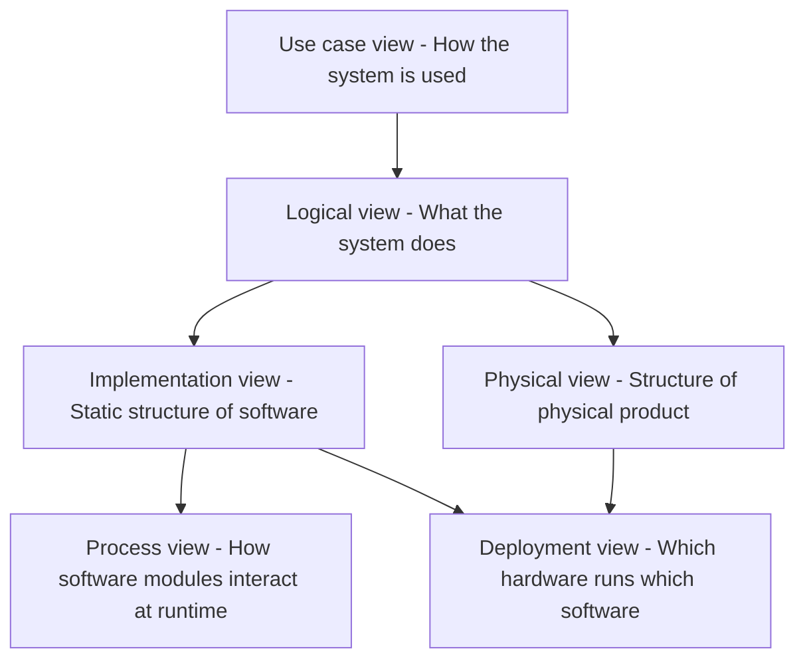

# The six views

ortho's views follow Kruchten's 4+1, with two changes. His Physical view is
split in two: **Physical** is the product itself — mechanics, electronics,
cabling and computers — and **Deployment** is which hardware runs which
software. And the **Logical** view holds the functions themselves, not the
structure that delivers them; that structure lives on Implementation and
Physical.

Start from what users need (Use case), sort it into functions (Logical),
realize them in software (Implementation) and hardware (Physical), place the
one on the other (Deployment), and show how the software talks at run time
(Process).

[LANGUAGE.md](LANGUAGE.md) says what to write for each view;
[README.md](README.md) how to render it.

## Use case view

How the system is used, and by whom — nothing about how it works.

Use cases are ellipses inside a rectangle named for the subject. Actors are
stick figures outside it: primary actors, declared on a use case definition,
on the left; secondary ones, added on a single use case, on the right.
Associations are plain straight lines, and an «include» is a dashed arrow to
the included use case.

## Logical view

What the system does, as a tree of functions, whatever ends up performing
them. Functions outlive their realizations: arming a mechanism has been a
hatch, a relay and firmware. Control functions — arming, interlocking,
sequencing — move between media; energy and material functions — containing
a volume, raising a temperature — do not.

Each function appears once, and names nothing that realizes it: the parts on
the Implementation and Physical views name their functions themselves. A
function nothing performs is a gap.

Drawn as a work-breakdown chart: one rounded box per function, each parent
above its children on a single stem, with no arrowheads. The lowest level of
a branch is listed vertically, so a broad tree keeps a page's proportions.

## Implementation view

The static structure of the software: modules, and the dependencies between
their packages. Run-time behaviour belongs to Process, hardware to Physical.

Packages are tabbed rectangles, nested, holding their modules. An «import»
arrow points at a package depended upon. A module's box lists the functions
it realizes (*perform actions*) and its API (*ports*: what it offers, and,
conjugated with `~`, what it needs). No lines join modules: where they
publish and subscribe rather than call, a line would claim a coupling that
does not exist.

## Physical view

The product as topology: what connects, mounts and wires to what.
Dimensions and placement are out of scope, and a cable is a connection, not a
part.

Drawn as an internal block diagram. Each part is a box headed `name : Type`,
nested in the part that contains it, so a type fitted twice is two boxes.
Ports are small squares on the border; connections are plain lines from port
to port, labelled with their interface where they have one. A part lists the
functions it realizes. Attribute values are not drawn.

## Deployment view

Which hardware runs which software — the only view whose subject is a
relation, between elements of Implementation and Physical.

Drawn by containment, not arrows: each computer is a three-dimensional box
with the software it runs inside, in a frame for the device it is fitted in.
A computer with nothing inside runs nothing.

## Process view

How the software modules interact at run time, in one scenario.

Drawn as a sequence diagram: a lifeline per module, or a stick figure for a
person, with activation bars. Messages are arrows between lifelines, in order
from top to bottom, labelled `name : Payload`.

## References

- Philippe Kruchten, "Architectural Blueprints — The 4+1 View Model of
  Software Architecture", *IEEE Software* 12 (6), pp. 42–50, November 1995.
- [OMG Systems Modeling Language (SysML)](https://www.omg.org/spec/SysML/) —
  the specification the grammar is written against.
- [SysML v2 Release](https://github.com/Systems-Modeling/SysML-v2-Release) —
  the language specification, textual notation and pilot implementation.
