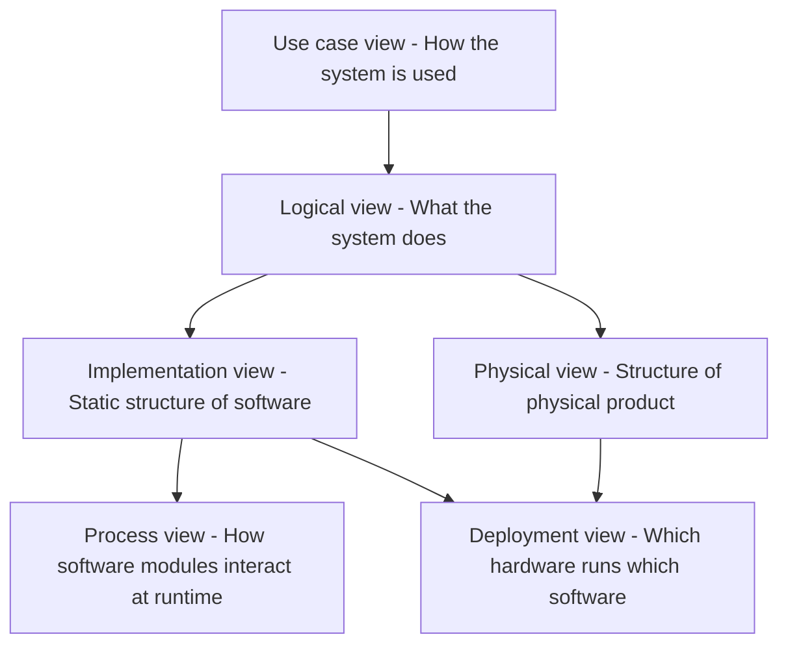

# The six views

ortho's views follow Kruchten's 4+1, with two changes. His Physical view is
split in two: **Physical** is the product itself — mechanics, electronics,
cabling and computers — and **Deployment** is which hardware runs which
software. And the **Logical** view holds the functions themselves, not the
structure that delivers them; that structure lives on Implementation and
Physical.

Start from what users need (Use case), sort it into functions (Logical),
realize them in software (Implementation) and hardware (Physical), place the
one on the other (Deployment), and show how the software talks at run time
(Process).

[LANGUAGE.md](LANGUAGE.md) says what to write for each view;
[README.md](README.md) how to render it.

Every view is drawn in SysML v2's graphical notation (§8.2.3). A definition
is a box with square corners and a usage one with rounded corners, each with
its keyword above its name: «part def», «part», «action». The frame's tab
names the view and its definition, and its bottom-right corner the file that
declares it.

## Use case view

How the system is used, and by whom — nothing about how it works.

Use cases are «use case» boxes. Actors are stick figures: primary actors,
declared on a use case definition, on the left; secondary ones, added on a
single use case, on the right. The subject is a «subject» box on the right,
joined to each of its use cases as an actor is. These lines are plain and
straight, and an «include» is a solid arrow to the included use case.

## Logical view

What the system does, as a tree of functions, whatever ends up performing
them. Functions outlive their realizations: arming a mechanism has been a
hatch, a relay and firmware. Control functions — arming, interlocking,
sequencing — move between media; energy and material functions — containing
a volume, raising a temperature — do not.

Each function appears once, and names nothing that realizes it: the parts on
the Implementation and Physical views name their functions themselves. A
function nothing performs is a gap.

Drawn as a work-breakdown chart: one box per function, the root an «action
def» and the rest «action»s, each parent above its children on a single stem.
The stem leaves the parent at a filled diamond, since the parent owns them. The lowest level of
a branch is listed vertically, so a broad tree keeps a page's proportions.

## Implementation view

The static structure of the software: modules, and the dependencies between
their packages. Run-time behaviour belongs to Process, hardware to Physical.

Packages are tabbed rectangles, named in their tab, nested, holding their
modules. A dashed «import» arrow points at a package depended upon, «import»*
where `Pkg::*` imports its members. A module's box lists the functions
it realizes (*perform actions*) and its API (*ports*: what it offers, and,
conjugated with `~`, what it needs). No lines join modules: where they
publish and subscribe rather than call, a line would claim a coupling that
does not exist.

## Physical view

The product as topology: what connects, mounts and wires to what.
Dimensions and placement are out of scope, and a cable is a connection, not a
part.

Drawn as an internal block diagram. Each part is a box headed `name : Type`,
nested in the part that contains it, so a type fitted twice is two boxes.
Ports are small squares on the border; connections are plain lines from port
to port, labelled as declared, `: Interface` where they have one. A part lists the
functions it realizes. Attribute values are not drawn.

## Deployment view

Which hardware runs which software — the only view whose subject is a
relation, between elements of Implementation and Physical.

Each computer is a «part» box listing what is allocated to it, `allocated
sw.recipes`, in its *relationships* compartment, inside the device it is
fitted in. Nothing is drawn inside a computer: a box drawn inside another is
its member, and software is not a computer's.

## Process view

How the software modules interact at run time, in one scenario.

Drawn as a sequence diagram: a lifeline per module, headed by a «part» box,
or by a stick figure for a person, as on the use case view, where SysML v2
would draw a «part» box too. Messages are arrows from lifeline to lifeline, in
order from top to bottom, labelled as declared: `name of Payload`.

## References

- Philippe Kruchten, "Architectural Blueprints — The 4+1 View Model of
  Software Architecture", *IEEE Software* 12 (6), pp. 42–50, November 1995.
- [OMG Systems Modeling Language (SysML)](https://www.omg.org/spec/SysML/) —
  the specification the grammar is written against.
- [SysML v2 Release](https://github.com/Systems-Modeling/SysML-v2-Release) —
  the language specification, textual notation and pilot implementation.
