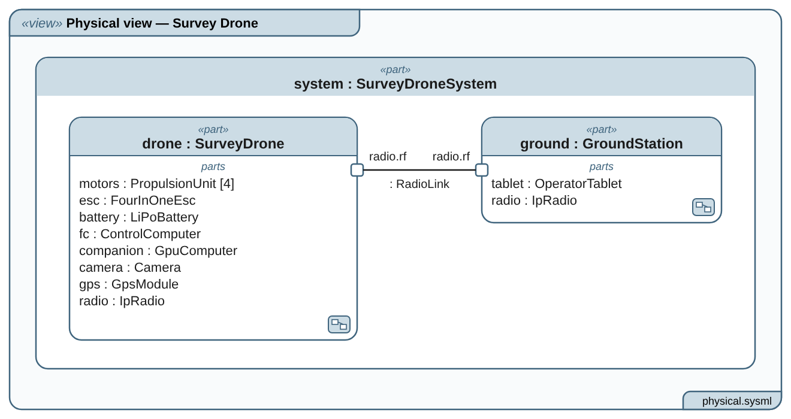
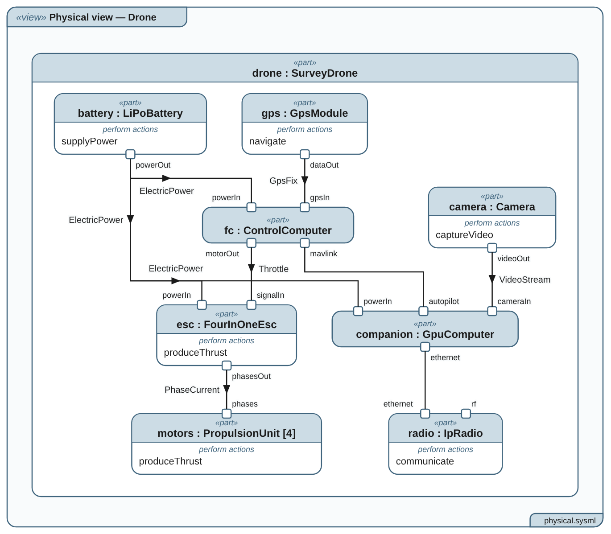

# Drill-down views

What the standard says, what tools do, and the options for Ortho. Researched
on 2026-11-27. **Decided on 2026-11-28: option 2, links first and then
folding.** The steps are in the backlog in [DEVELOPMENT.md](../DEVELOPMENT.md#backlog).

## In short

SysML v2 has no "click to drill down" feature and no drill-down symbol. What it
does have fits the idea well: **a diagram is a view, and so is every
compartment of a box** (§7.26.5), views can nest inside views, and a box can
show its contents as a *textual* compartment (a list of its parts) instead of
drawing them. Drill-down is something tools add in their user interface.

So Ortho can do it without inventing any language. The model already says
which views exist and what each one exposes. Ortho can use that to fold a box
that has a view of its own and link the box to that view. You split a big
view into levels the way MBSE practice does, and Ortho makes the levels
navigable. Nothing is merged or dropped: every element is still drawn in
full, on the next level down.

## What the standard says

- **A view picks what to show with `expose`**, which works like an `import`:
  `expose X;` gives X itself, `expose X::*;` gives X's members, and
  `expose X::**;` gives all levels below X (§7.26.2, Table 24 uses
  `expose part1::**`). The spec says recursive expose "is useful for exposing
  elements from hierarchical models". (Ortho today draws everything inside an
  exposed element and ignores `::*` and `::**`.)
- **A diagram is a view, and a compartment is a view too** (§7.26.5,
  §8.2.3.1). "A graphical node within the graphical compartment of a diagram
  can also have compartments that are view usages … This provides a mechanism
  to nest views within other views." The same part can show its insides as
  nested boxes, or as a `parts` list in a textual compartment.
- **Compartment lists may end in `…`** in the graphical grammar (for example
  `members-compartment-contents = members-compartment-element* '…'?`), so the
  notation allows a box to show less than the model holds.
- **Views nest and are ordered** to build composite artifacts, such as "a
  document, where each nested view usage corresponds to a section" (§7.26.1).
  The library's `View` has `subviews`, and `Rendering` has `subrenderings`.
- **A diagram may draw a view as a box** (`«view»`) with an `«expose»` arrow
  to what it shows (Table 24), and a view can sit inside another view as a
  framed view (§8.2.3.26).
- **`BrowserView`** in StandardViewDefinitions is the only place the library
  mentions interaction: "collapsible-expandable nodes", as an indented tree,
  not a diagram.
- **Nothing defines navigation, double-click or a drill-down marker.** How a
  rendering is carried out is left to tools: "there are no specific constructs
  provided in SysML for specifying that" (§7.26.4).
- Note that `expose system.drone;` does not parse: expose takes a qualified
  name, not a feature chain. `expose system::drone;` does, and Ortho already
  draws it (see the drone view below).

## What other tools do

| Tool | How you dig deeper |
|---|---|
| Cameo / MagicDraw (CATIA Magic) | Each element has navigation targets, and one is active: double-clicking a block opens its internal block diagram. An icon on the symbol marks that it has one. |
| Enterprise Architect | A "composite element" points to a child diagram. Double-click opens it, and a small icon in the bottom-right corner marks it. The child diagram can also be shown inside the element as a frame. |
| Capella | No built-in zoom in or out. Users draw one diagram per level and link them with "representation links" that open on double-click. |
| PTC Modeler (Rhapsody-like) | Right-click a block, then Open, then the IBD you want. |
| SysON (SysML v2, web) | No jumping between diagrams. Boxes expand and collapse in place, and new elements are collapsed by default. |
| Tom Sawyer SysML v2 viewer | Expand and collapse in place, no child diagrams. |
| Structurizr (C4, for comparison) | Double-click an element marked with a zoom-in sign to open the next level's diagram. |

Two families, then. The classic tools (Cameo, EA, Capella, Structurizr)
link a box to **another diagram**, and mark that box with a small icon. The
new SysML v2 viewers (SysON, Tom Sawyer) **expand and collapse in place**.

## Options for Ortho

### 1. Links between the views you already have (small)

A box whose element another view exposes gets a small mark in its bottom-right
corner, as in EA and Cameo. In the previews, clicking the mark opens that
view's tab, and the view's tab offers a way back up. In the SVG it is a plain
`<a href>` to the other SVG, so it also works when the file is opened in a
browser. Clicking anywhere else on a box still opens its source line, as it
does now. No model change, nothing hidden.

This helps navigation but **not A4**, because the upper view still draws
everything inside.

### 2. Fold what has a view of its own, and link to it (recommended)

As option 1, and in addition: when a view exposes an element nested inside
what another view draws, the upper view draws that element **closed**. It
keeps its ports and the connections to them, and lists its parts in a
standard `parts` textual compartment instead of drawing them. The modeller
divides the model by adding a view per subsystem. Ortho turns that into
levels.

```sysml
view 'Physical view — Survey Drone' : InterconnectionView {
    expose system;            // drawn with drone and ground folded
}
view 'Physical view — Drone' : InterconnectionView {
    expose system::drone;     // the next level down
}
view 'Physical view — Ground station' : InterconnectionView {
    expose system::ground;
}
```

**Top level, folded (mock-up, hand-drawn):** the drone and ground station are
closed, with their parts listed, and the mark opens their own views.



**One level down:** Ortho 0.6.0 already draws this from the extra view above.



The same rule works in the other views:

- **Logical:** a branch that has its own view (`expose MakeBeverage::prepareWater;`,
  already supported) is drawn as one box with the mark, without its sub-tree.
- **Implementation:** a package with its own view is a closed package box
  listing its modules, and its imports are kept.
- **Physical and Deployment:** as in the mock-up.

Questions to settle before building it:

- **A connection into a folded part.** In the mock-up, `drone.radio.rf` ends
  at the drone's border. Should the port carry its full path (`radio.rf`), or
  only the name of the port inside?
- **Paper.** On a printout the mark cannot be clicked. Should the mark stay
  only an icon, or should the folded box also name its view?
- **Opt-out.** Should a view be able to draw everything anyway? The strict way
  would be `expose system::**;`, which, read literally, asks for all levels.

### 3. Expand and collapse in the preview (not recommended)

As SysON and Tom Sawyer do: click a box to open or close it in place. It feels
nice on screen, but the saved SVG would depend on what someone clicked, while
Ortho's rule so far is one model, one picture. It also does not help A4,
because a printout needs one fixed state.

## Recommendation

**Option 2, built in two steps.** First the links (option 1), which are useful
on their own and change no drawing. Then folding, starting with the physical
and logical views, where the hierarchy is deepest. It follows the standard's
own idea of nested views and compartments, matches what Cameo, EA and Capella
users expect, and solves A4 the MBSE way: one view per level, each readable on
its own page, and none of them dropping anything.

## Sources

- SysML v2.1 Beta 2, Part 1: §7.26.1–7.26.5, §8.2.3.1, §8.2.3.26, Table 24;
  Systems Library `Views.sysml` and `StandardViewDefinitions.sysml`
  (Systems-Modeling/SysML-v2-Release).
- [Enterprise Architect: Composite Elements](https://www.sparxsystems.com/enterprise_architect_user_guide/15.0/modeling/compositeelements.html)
- [MagicDraw: Manage Navigation](https://docs.nomagic.com/x/FA4mC)
- [Capella forum: connect diagrams with a double-click?](https://forum.mbse-capella.org/t/am-i-able-to-connect-diagrams-with-a-double-click/6202)
  and [Navigating hierarchical system architecture](https://forum.mbse-capella.org/t/navigating-hierarchical-system-architecture-in-capella/10851)
- [PTC Modeler: Opening an internal block diagram](https://support.ptc.com/help/modeler/r10.1/en/Modeler/sysml/Opening_an_internal_block_diagram.html)
- [SysON: General view](https://doc.mbse-syson.org/syson/main/user-manual/features/general-view.html)
  and [Interconnection view](https://doc.mbse-syson.org/syson/main/user-manual/features/interconnection-view.html)
- [Tom Sawyer SysML v2 Viewer 2.0](https://www.tomsawyer.com/news/sysml-v2-viewer-2-0-broadens-sysml-v2-syntax-coverage-and-optimizes-model-layout)
- [Structurizr: Diagram navigation](https://docs.structurizr.com/ui/diagrams/navigation)
