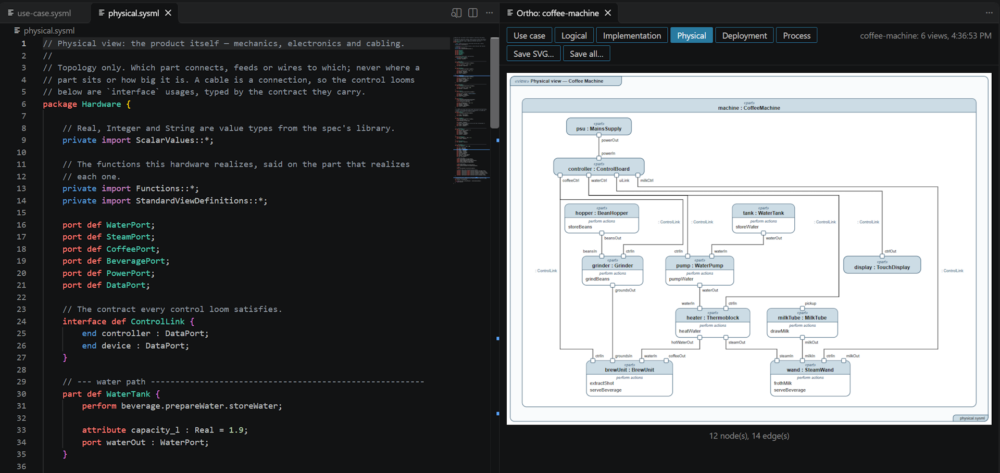

# Ortho for SysML v2

**See the architecture while you write the model.** Ortho draws six
architectural views of a SysML v2 model, in SysML v2's own graphical
notation: use case, logical, implementation, physical, deployment and
process. It shows them beside the text and draws them again every time you
save.

It is made for models that AI agents write and people review. ortho's checks
land in the Problems panel, and an agent working in VS Code's terminal checks
its work with the same ortho as the preview.

## Getting started

1. Run **Ortho: Open Example** from the Command Palette (Ctrl+Shift+P, or
   Cmd+Shift+P on a Mac) and pick one: a coffee machine, a survey drone or a
   web shop on AWS. It is copied into a folder you choose and opens with the
   preview beside it.
2. Change the model and save. The diagrams follow.
3. For a model of your own, open a `.sysml` file and click the preview button
   at the top right of the editor, or press Ctrl+K V (Cmd+K V on a Mac).

The extension carries ortho, built for your system, so there is nothing else
to install.

## Features

- **SysML v2 coloring:** keywords, the names that definitions and packages
  declare, comments, strings, quoted names, numbers and metadata such as
  `#Safety`. The keywords are exactly the ones ortho reads. Ctrl+/ comments a
  line.
- **The diagrams beside the model,** a tab for each view. Click a box to open
  the line that declares it; click elsewhere to switch between fitting the
  panel and actual size.
- **Problems where you write.** A name that does not resolve, a syntax error,
  or two views that disagree, such as a function nothing performs, is
  underlined and listed in the Problems panel. While the model does not load,
  the last diagrams stay, faded.
- **SVG for documents and slides.** *Save SVG…* saves the view shown, and
  *Save all…* every view into a folder, exactly as `ortho render` writes them.
- **AI instructions.** *Ortho: Add AI Instructions* writes a skill for Claude
  Code, instructions for GitHub Copilot and, unless the workspace has an
  agent file already, an `AGENTS.md` for other agents. They carry the SysML v2
  ortho reads, and tell the agent to render after every change and fix what
  ortho reports. It asks before replacing a file.

## Your model

A model is every `.sysml` file in the folder of the file you preview, read
together. It draws only the views it declares, with SysML v2's standard view
definitions: [LANGUAGE.md](https://github.com/ola-coding/ortho/blob/main/LANGUAGE.md)
says what to write for each, and
[VIEWS.md](https://github.com/ola-coding/ortho/blob/main/VIEWS.md) what each
shows.

## Settings

| Setting | Default | What it does |
| --- | --- | --- |
| `ortho.path` | empty | The ortho to run, as a command or a path. Empty runs the one the extension carries. |
| `ortho.theme` | `light` | `light` for documents, or `dark-glass`, a transparent version for dark slides. |

VS Code's terminals get the same ortho first on their PATH, so `ortho render`
there draws what the preview does. In a folder you have not trusted, its own
`ortho.path` is ignored, so a cloned repository cannot choose what the
extension runs.

## Privacy

The extension collects no telemetry and makes no network calls, and neither
does ortho. The diagrams stay in VS Code's storage until you save them.

## More

ortho is also a command-line program, for rendering the diagrams in CI so they
never drift from the model: see
[ortho on GitHub](https://github.com/ola-coding/ortho), where
[issues](https://github.com/ola-coding/ortho/issues) are welcome.
